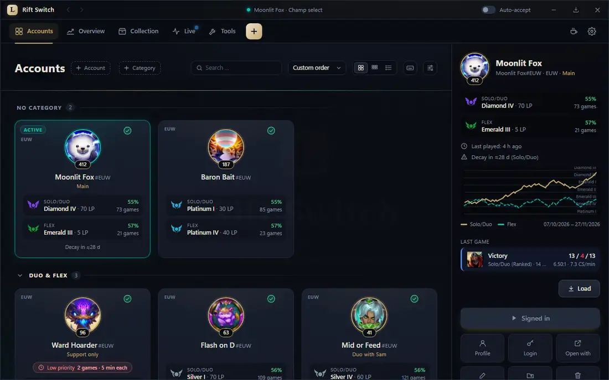
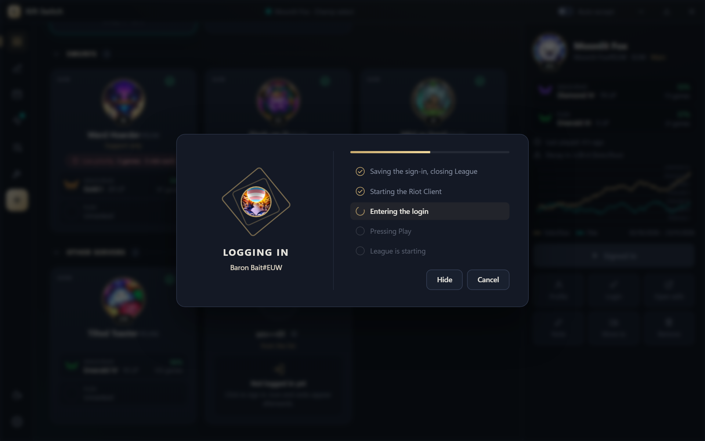
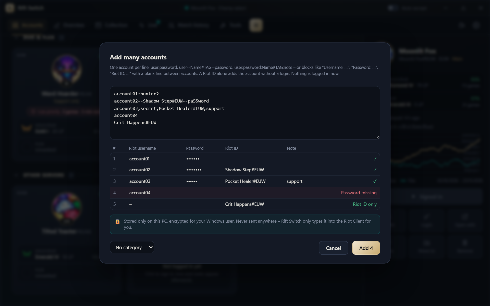
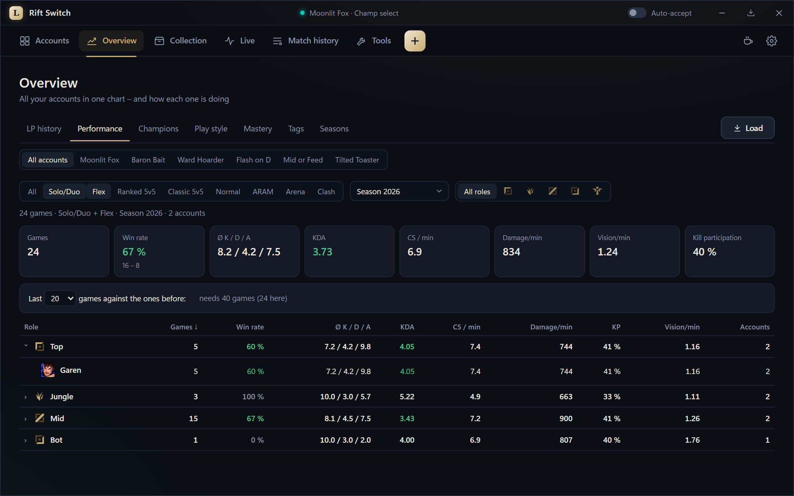
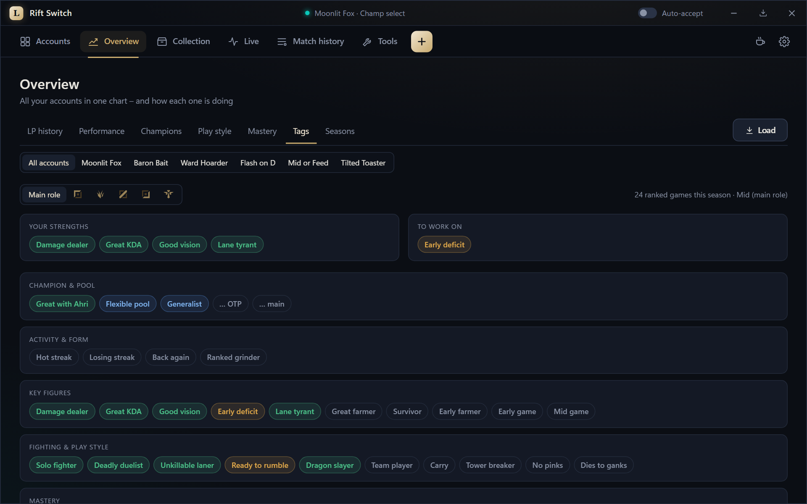
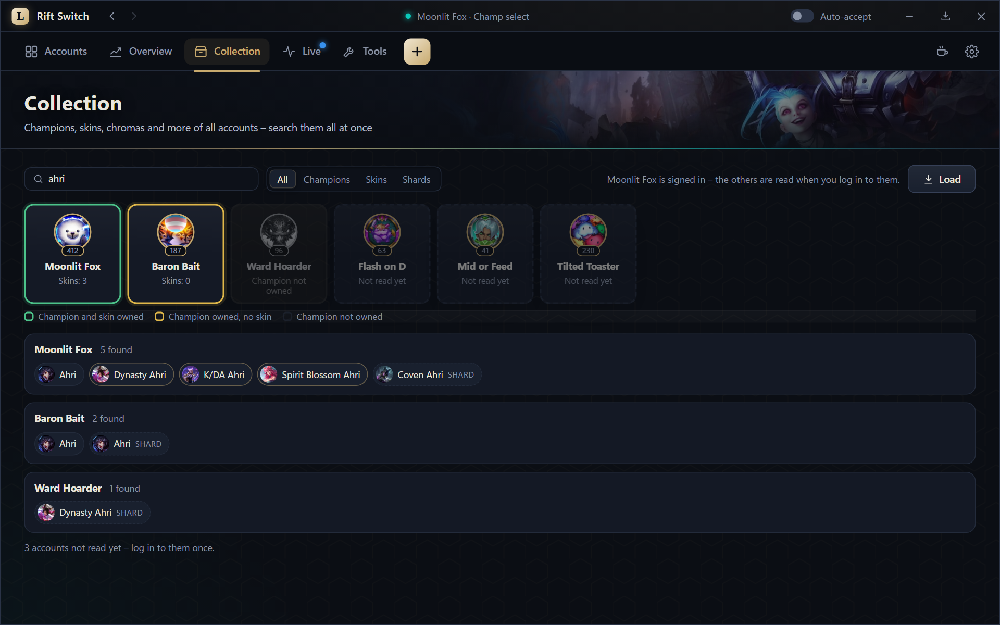
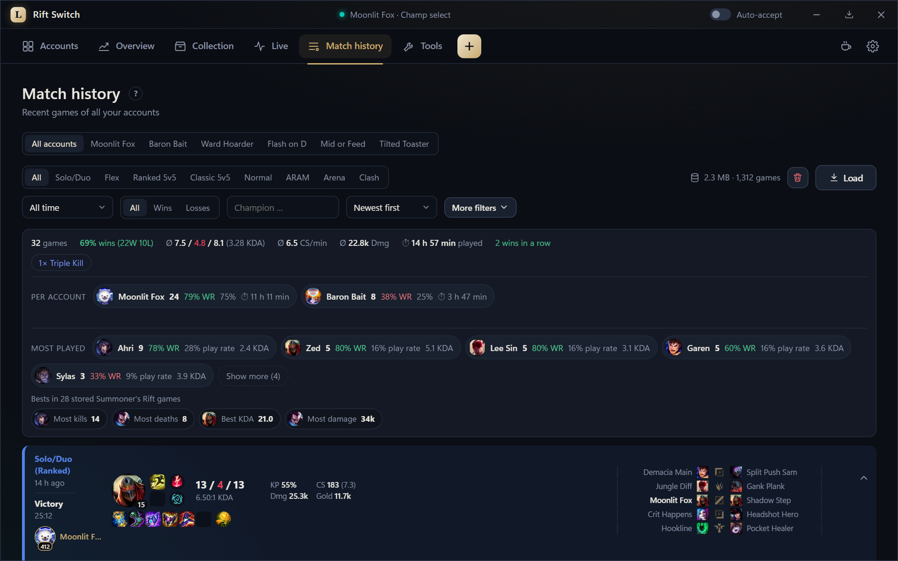
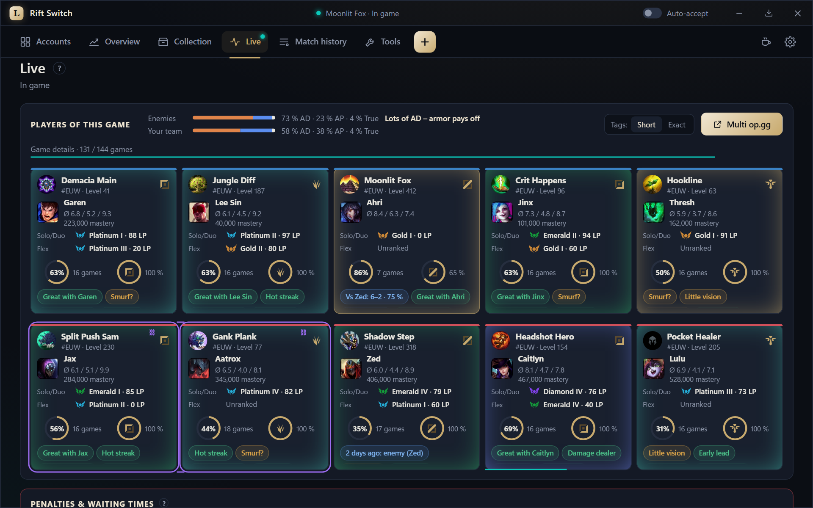
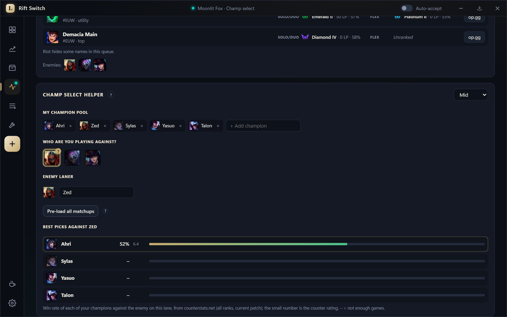

<div align="center">


# Rift Switch

**The local multi-account companion for League of Legends.**<br>
Pick an account, press **Log in** – League restarts with it. No typing, no logging out by hand.

[](https://github.com/Zlizz3R/rift-switch/releases/latest)
[](https://github.com/Zlizz3R/rift-switch/actions/workflows/ci.yml)


[](LICENSE)



<sub>Sharper: <a href="docs/demo.mp4">the same video as MP4</a></sub>

<sub>Every account in the pictures is made up (`tools/screens/demo.js`).</sub>

</div>

## Why Rift Switch

- **One click per account** – it saves the Riot Client's *Stay signed in* session of every account and swaps it back
  in. Passwords are optional.
- **Everything about your accounts in one window** – ranks, performance, traits, mastery, match history, LP history,
  penalties and collection – across all accounts at once.
- **Light** – about **8 MB** in the tray with no window and almost no CPU, a **2 MB** installer. Rust + the WebView2
  that comes with Windows; no Electron.
- **Private** – logins and sessions never leave your PC (encrypted for your Windows user). No account, no tracking, no ads.
- **11 languages** – English, Deutsch, 中文, हिन्दी, Español, Français, العربية, বাংলা, Português, Русский, اردو.

## Download

**[⬇ Latest release](https://github.com/Zlizz3R/rift-switch/releases/latest)** → `Rift Switch_x.y.z_x64-setup.exe`

Start menu shortcut, uninstall via Windows settings, and it updates itself. The app isn't code-signed (that costs a
few hundred euros a year), so Windows SmartScreen may say *“Windows protected your PC”* – click **More info → Run
anyway**. The full source is right here.

---

## The pages

### 👤 Accounts


- **Log in** with a double click, the button in the panel, the tray menu or the Windows jump list. The app checks
  where the Riot Client is first: already signed in → it just presses *Play*; login screen open → it signs in
  without a restart; otherwise it leaves your lobby, closes League, swaps the session and presses *Play* for you.
- **Every tile** shows Riot ID, icon, level, server and ranks (Solo/Duo, Flex, Ranked 5v5, Classic 5v5) with win
  rate – which of these you see is up to you (the slider button).
- **The panel** on the right: ranks, last played, decay warning, LP chart, profile, saved login, *Open with* (op.gg,
  Porofessor, League of Graphs, Mobalytics, u.gg), note, move and remove.
- **Penalties on the tile** – leaver locks and dodge timers with the time left; a low priority queue with the games
  left and the wait per game.
- **Ranked readiness** – what a fresh account still needs (level 30, 20 champions, 10 normal games) plus Riot's own
  restrictions.
- **A new Riot ID** (renamed outside the app) – the tile takes it over and says so once; the old name stays in
  the panel and the search still finds it.
- **Categories**, search, sorting, drag & drop, and **several at once**: Ctrl+click, Shift+click or draw a box – then
  note, category, *Open with* or remove for all of them.

<details>
<summary><b>Three layouts</b> – tiles, small tiles or a list</summary>


The list shows what the tile options switch on; clicking, the menu, dragging and picking work just like on tiles.
</details>

<details>
<summary><b>Logging in, step by step</b></summary>



Saving the sign-in, Riot Client, entering the login, *Play*, League starting – you can hide it or cancel.

- An account with a **penalty** (leaver lock, low priority, dodge timer) always asks first.
- After the login the app checks that the **account you picked** is the one that signed in.
- **Code or captcha?** You get clear steps and an *Open Riot Client* button – the app notices the sign-in and goes on
  by itself.
</details>

<details>
<summary><b>Adding many accounts at once</b></summary>



Paste a list – one account per line: `user:password`, `user--Name#TAG--password` (LeagueAccounts format),
`user;password;Name#TAG;note` (also tab or `|`), a Riot ID alone, or blocks of `Username: …` / `Password: …` /
`Riot ID: …` lines. You see what was understood (and what wasn't) before anything is saved, and you can put them all
into one category.
</details>

### 📈 Overview



- **One page for your accounts and for anyone else**: a head with the splash art of the champion played most,
  the avatar(s), Solo/Duo and Flex with their crest, the account chips – and the **player search** (Ctrl+K).
  The same tabs for everyone: **Performance**, **Traits**, **Mastery**, **Match history**, **LP history** and
  **Seasons** – another player's page has all of them but the LP history, plus *Open with* and the games with you.
- **Showcase** – your favourite skins, icons, ward skins and emotes from all your accounts in the Overview's head,
  over the splash art: any mix, your order, small, medium or large (*★ Showcase* next to the search). Only you see it.
- **Performance** – the start page: one strip with the key figures (games with wins and losses, win rate, KDA, CS,
  damage, kill participation, vision), each with its trend – the last 10 games against the 10 before – and your
  traits right next to them (*Traits →* opens them all). Then the champions, the roles, the play style and the map.
  The queues start on *All ranked* (Solo/Duo, Flex, Ranked 5v5, Clash); an ARAM player starts on ARAM (the share of
  the team instead of roles and play style, and ARAM's own map).


- **LP history** – every account in one chart, on coloured tier bands. Hover: every account's rank on that day.
- **Any combination of queues** – Solo/Duo, Flex, Ranked 5v5, Classic 5v5: one colour per account, one line style
  per queue.
- **7 / 30 / 90 days or everything** – ranked games, wins and losses, LP won or lost and the best climb, for all
  accounts together and for each one.
- **A goal per account and queue** (e.g. Diamond II) with a progress bar and the LP still to go.
- **Key figures** across all accounts (games, win rate, LP, best climb, most played champion, busiest account) and each
  account's **season peak** and last season's rank, straight from the client.

<details>
<summary><b>Performance, champions, play style, map, traits, mastery, seasons</b></summary>

- **Performance** – one page with one filter (account, queue, season, last 7 / 30 / 90 days or your own dates, role –
  and **only the newest games**: last 10, 20, 50, 100, 200 or a number of your own): the strip with the key figures
  and the traits on top, then four cards – Champions left of the others on a medium window, three columns on a wide one:
- **Champions** – the op.gg-style list: KDA, CS, win rate and games per champion. **A click on a champion** shows only
  its games on every other card – figures, traits, map, roles, play style (again, or ✕: every champion); its ↗ opens
  those games in the match history.
- **Roles** – each position's share of your games, with its win rate.


- **Play style** – a radar of you against your lane opponent in the same games (farm, damage, gold, kill
  participation, vision, survival, lane phase, towers); 100 % = as good as him. No total score.
- **Mastery** – every champion's points over all accounts, milestones, and the play time behind them
  (points ÷ points per game × game length + 7 minutes around each game). Riot changed the points in May 2024 (~500 a
  game before, ~1,200 after): a slider says how many of your games were played before – 50 % means 850.



- **Traits** – "Great farmer", "Lane tyrant", "Dies to ganks" …: your strengths and things to work on from your ranked
  games, per role – or *All roles* at once, each tag with its role and that role's share of your games – each with
  the numbers behind it. "Too little data" is never shown as "not met".
  **ARAM** has traits of its own (damage dealer, team fighter, frontliner, healing machine, CC machine, multikill
  hunter, team carry, finisher, enabler, poke master, tower crusher, first blood hunter, never gives up, late or early
  game …), measured against the ARAM games of the other players – also on Live's cards in an ARAM game.
  Other players (Live, the player page) only get what speaks for them – the things to work on are for your own accounts.
- **Map** – Summoner's Rift or ARAM's map (its one lane from base to base: own base, own towers, the middle, enemy
  towers, enemy base; a switch when the games are on both; Arena has no map) – where you die and where you kill (both at first, or deaths or kills; the same filter: account, queue, season,
  role), for a game phase – before 10 minutes, 10–20, after 20 – or any minutes you pick on the minute chart
  under the map (kills up, deaths down). Seen from the blue side, with the spots that stand out ("Before 10 min:
  45 % of the deaths: top river") and every zone's share, deaths and kills side by side.
- **Seasons** – what the client tells about the last season, your stored games per year, and earlier seasons you
  paste in yourself – three sources, never added up.
</details>

### 🧰 Collection



Owned champions, skins and loot shards of every account – and **one search across all of them**: which account has
Ahri, a K/DA skin or an Ashe shard? Without a search: champions, skins, chromas, ward skins, icons, emotes, finishers,
rune pages and Blue Essence per account, and all accounts together. (Read while you are logged in to that account.)

### 📊 Match history



A tab of the Overview – its accounts are the Overview's chips.

- **Every game of every account** in one list, kept by Rift Switch itself – no limit, also with League closed.
  One **Load** button (on every page) fetches everything at once: collection, mastery, ranks and the 200 newest
  games of every account – the most the League client hands out. Rift Switch keeps them all, so the history grows
  with every Load – and it **loads by itself** when an account signs in (Settings → Logging in; once per account in
  30 minutes, never while queueing, in champion select or a game). Your own games also keep the client's raw data (gzip, up to 2 × 100 MB); other players'
  games (from Live) stay 30 days – a year in their short form from the match list – and at most 1 GB (Settings → Data: 500 MB to 5 GB).
- **Filters**: account, any combination of queues, time or your own dates, wins/losses, champion, sorting, and more
  (kills, deaths, KDA, multikills). The summary above the list counts what the filters show: win rate, KDA, CS/min,
  damage, time played, the usual game length, days played and the busiest weekday, streaks and records.
- **Most played**: your top five champions, games and **play time per account**, and the teammates you played with
  most – each with its win rate. **Clash** and **Custom** games have their own filters.
- **Click a name** (here, on Live or after a game): the **player page** – the same page as your own Overview for any
  player, from their 200 newest games (the newest ranked ones read in detail): *Performance* (key figures, traits,
  champions, roles, play style, map – by queue and role), *Traits*, *Mastery* (their points and the play time behind
  them), *Match history* (the games with you on top) and *Seasons* – with *Open with* (op.gg …). **Back / forward** arrows in the title
  bar (also Alt+← / Alt+→ and the mouse's side buttons) go through the pages like a browser. The **search** in the
  Overview's head (Ctrl+K) finds anyone: suggestions from everyone in your games, any other Riot ID looked up through
  the client (without a tag: your server's, like EUW). League closed? The page says so instead of waiting.
- **Open a game**: every player's stats, items, runes and ranks (and in Arena and ARAM: Mayhem every player's
  augments, right of the gold), team gold over time (hover for the lead at each
  minute), any two players side by side – and its **replay**: download it and watch it in League (games of the
  current patch on the server League runs on).

### ⚡ Live


- **Lobby, champion select and in game** – everyone's Solo/Duo and Flex rank, and a **Multi op.gg** button for the
  enemy team.
- **Clash** – your next opponents with their ranks as soon as the bracket is out.
- **Penalties & waiting times** right on the row of whoever has them in the lobby – your own accounts and the other
  players the client names – and of the account you are on in champion select or a game.



- **The ten players of your game** from the loading screen on: two rows, lane opponents face to face, rank, win rate
  on this champion, main role, mastery and traits in three tiers (*Key*: what you can act on, *More*, *All* – the rest of a card behind
  "+n") – from each player's 200 newest games (all ten players' details
  for the newest 50 ranked ones), loaded from the client as fast as it answers – every match list at once, then 12
  games on their way at all times (when one comes, the next starts), the players in turn – everyone's newest game
  first – each game and its timeline together, with a progress bar; during the game 10 at a time, also while the
  window is in the tray, and a short pause when the client starts refusing. Every round goes into `scout.log` (how
  long the lists, details and timelines took, what was refused, when all was there). **Premades** (your own lobby, and others who played together before) get a coloured frame, players you met before a tag ("Yesterday: enemy (Kennen)"), and each
  team's **damage mix** (AD / AP / True) shows what to build against.
- **After the game**: the overview of both teams stands the moment the end screen opens – while you still honor –
  from the client's end-of-game numbers: K/D/A, CS, items, damage, taken, gold, MVP / ACE. When the match history
  has the game it takes over (with what changed in your tags, ▲ / ▼); lane against lane, the gold lead and the replay
  are one click away in the match history.
- A **blue dot** on *Live* while a game is on (champion select or in game), whatever page you are on.

<details>
<summary><b>Champ select helper</b></summary>



Keep a pool of your champions – typed in, or *Add from match history*: every champion you played 3+ times on the lane in
the last 180 days. The lane is the one Riot assigned you, else your main role from the match history until you pick one. Both teams
are shown lane by lane: yours as assigned, the enemies guessed from a **lane table of every stored game** – your own
and every other player's game Live and the player pages read (also the short ones from match lists), each player
once, by month for half a year (this and last month count fully). It grows with every game you play with the app
open. In champion select the enemy picks appear as pictures – Riot hides their positions, so the app marks the
likely laner (all five placed together). Your pool is ranked against him by the **matchups in the stored games** (every
game with all ten players: who met whom on this lane, and who won), with the number of games – plus your own record
against him and your win rate on each champion. Nothing is fetched from websites; *counterstats.net ↗* opens that
site in your browser if you want a second opinion.
</details>

### 🔧 Tools & settings

- **Tools** – refresh ranks, close all Riot processes, restart League, clear the Riot Client cache (sign-ins stay),
  open the logs or the app's data folder, **save a diagnostics file** for a bug report (names, ids and your user
  folder are taken out).
- **Keyboard** – Ctrl+F search, Ctrl+1…6 pages (Ctrl+5: the match history), Ctrl+N add (Ctrl+Shift+N many), arrow keys + Enter to log in,
  E note, P profile, Del remove, Ctrl+A pick all – `?` shows them all.
- **Auto-accept** in the title bar, **streamer mode** (hide names, ranks … – you choose), system / light / dark,
  interface size, app lock with a password (and Windows Hello to show a saved password).
- **Export / import** – without logins (a safe backup), or with logins encrypted by a password of their own
  (scrypt + AES-256). Riot Client sign-ins, the app password and the match history are never in the file.
- **What's new** after every update, **tray app** (⬇ keeps it in the tray, ✕ quits), start with Windows.

---

## How it works – and what it stores

- **An account is a snapshot** of the Riot Client's *Stay signed in* session
  (`%LOCALAPPDATA%\Riot Games\Riot Client\Data`). Logging in restores that snapshot.
- **A password is optional** – for when a session has expired. It is typed into the Riot Client window
  (`src-tauri/scripts/autofill.ps1`, *Stay signed in* ticked); the app never talks to Riot's servers itself. It only
  types when it recognised the login form, only while the Riot Client is the front window, and it checks that every
  click lands on the Riot Client.
- Everything is stored in `%APPDATA%\rift-switch`, with a daily backup of your accounts for the last 5 days (`backups\`). Sessions and passwords are **encrypted with Windows DPAPI** – only
  your Windows user on your PC can read them. The lane table of the champ select helper (`lanes.json`, a few KB) is
  counted from the stored games on your PC.
- **Outside connections** (the same list is in the app: Settings → About → *Data sources*) – no account data is sent
  anywhere:
  - **CommunityDragon** – icons, rank emblems, champion, skin and item pictures.
  - **GitHub** – every 6 hours: is there a newer version? The installer is checked (size, SHA-256) and only runs when
    you say so.
  - op.gg and the other sites only when you open a profile there yourself.
- **On your PC only**: the Riot Client and League Client API (`127.0.0.1`) – the same local interface the client uses
  itself.

> ⚠️ The local client API is used by many community tools but is not officially supported by Riot.
> Automatic login and auto-accept only do what you would do by hand – use them at your own discretion.

## Troubleshooting

| Problem | What to do |
|---|---|
| *Riot Client not found* | Install the Riot Client (or start it once by hand), then try again. |
| The login screen or sign-in wasn't ready in time | Open the Riot Client once by hand – it may be updating – then log in again. |
| League doesn't start after logging in | Make sure *Start League automatically* is on (Settings → Logging in). The app presses *Play* as soon as the Riot Client accepts it. |
| "Log in once by hand" | The account has no saved sign-in yet (or it expired and no password is saved): log in once in the Riot Client with *Stay signed in*. |
| A code or captcha while signing in | Click *Open Riot Client* in the box, enter the code or solve the captcha – the app notices the sign-in and goes on. |
| Signed in as another account than picked | The saved login of that account belongs to another Riot ID: open *Login* on the tile and fix it. |
| Ranks, collection or match history stay empty | They come from the League client: open League on that account once. Accounts of another server are filled in when League runs on that server. |
| The Riot Client window is blank or broken | Tools → *Clear Riot Client cache* (sign-ins stay), then restart League. |
| Anything else | Tools → *Save diagnostics* and attach the file to an [issue](https://github.com/Zlizz3R/rift-switch/issues). |

## Build from source

Requires [Rust](https://rustup.rs) (with the Visual Studio C++ build tools) and [Node.js](https://nodejs.org) on Windows.

```powershell
git clone https://github.com/Zlizz3R/rift-switch.git
cd rift-switch
npm install
npm run dev      # run it
npm run dist     # installer in src-tauri/target/release/bundle/nsis/
```

<details>
<summary><b>Development notes</b></summary>

- `src-tauri/src/` – the background part (Rust, Tauri 2):
  `main.rs` window, tray, the one `call` command the window uses, logging in, polling;
  `riot.rs` Riot Client / League Client API, sessions, processes; `events.rs` client events (WebSocket);
  `live.rs` live page data, champion data, matchups; `matches.rs` the match history store (no limit:
  `matches/games.jsonl`, only an index stays in memory); `lanes.rs` the lane table of every stored game;
  `accounts.rs`, `ops.rs`, `settings.rs`, `store.rs`, `secrets.rs`, `menu.rs` – pure logic with tests;
  `updater.rs` GitHub releases; `winsys.rs` autostart and jump list
- `src-tauri/scripts/` – typing a login into the Riot Client (UI Automation, picture scan as fallback), closing the PBE dialog
- `ui/` – the window (`index.html`, `style.css`; `tauri-api.js` is its link to the background part):
  - accounts and frame: `renderer.js`, `views.js` (also Live and the champ select helper), `bulk.js` + `bulkparse.js`,
    `keys.js`, `changelog.js`
  - Overview: `summary.js` (the head of the Overview and the player page, every page's picture),
    `dashboard.js`, `ovfilter.js`, `perf.js` (Performance, the start page) + `perfmath.js`, `radar.js` + `radar-view.js`,
    `deathmath.js` + `deaths-view.js`, `mastery.js` +
    `mastmath.js` + `playtime-rules.js`, `seasons-view.js` + `seasonparse.js`, `insights.js`
  - tags: `tag-rules.js` (every threshold, Summoner's Rift and ARAM), `tags.js` (the engine), `tags-view.js`;
    thresholds from the stored games: `node tools/tag-thresholds.js`, `node tools/aram-thresholds.js`
  - collection: `collection.js`; match history: `matches-view.js`, `matchfilter.js`, `postgame.js`
  - Live: `scout-view.js` (the ten cards), `live-more.js` (premades, damage mix, helper by phase)
  - shared figures: `stats.js` (every key figure), `rankmath.js`
  - texts: `i18n.js` (English, German) + `lang/*.js` (loaded only when chosen)
- Tray and jump-list texts are copied from the window's texts: `npm run strings` after changing one
- Tests: `npm test` (the real window in jsdom with a fake background part + `cargo test`); they run on every push
- Pictures and the promo video: `node tools/screens/demo.js`, then `python tools/screens/capture.py` (headless Edge,
  ffmpeg; `shots` or `film` for one of the two) – `docs/demo.webp` in this README, `docs/demo.mp4`
- How fast the League client hands out match history (for Live's pace): `node tools/lcu-speed.js` while League is
  open – best during a game; only reads, prints no names
- Releases: add the version's notes to `ui/changelog.js` (the app's *What's new* and the release text,
  `node tools/release-notes.js vX.Y.Z`), then `npm run release X.Y.Z` – it runs every check of the release workflow
  first (on main, nothing uncommitted, changelog entry, `cargo fmt --check`, clippy, all tests), sets the version in
  `tauri.conf.json`, `Cargo.toml` and `package.json`, commits and tags; `--push` also pushes main and the tag.
  GitHub Actions then builds and publishes the installer, installed copies update themselves
- Test copy on its own data folder: `$env:RS_DATA='<folder>'; .\src-tauri\target\debug\rift-switch.exe`
  (never touches autostart, the jump list or the real data)
- **After every change** (AI helpers working on this project do all of this on their own):
  1. run **all** tests: `npm test` (the window tests and `cargo test`);
  2. **commit** – right away, without asking;
  3. **build again** with `npm run dist`, so `Rift Switch.cmd` (it starts
     `src-tauri\target\release\rift-switch.exe`) runs the new version. A running Rift Switch locks that
     file – it is **not** closed: first delete a `rift-switch.old.exe` left from an earlier build (if one is
     there and no longer runs), then rename the running `rift-switch.exe` to `rift-switch.old.exe`
     (Windows lets a running program be renamed) and build;
  4. **tell the user how to try it**, every time, in this form (German):
     *„Zum Ausprobieren: Die neue Version ist gebaut. Deine laufende Rift Switch ist noch die alte, ich habe
     sie nicht beendet, sondern ihre EXE nur zu rift-switch.old.exe umbenannt. Beende sie also über ✕ und
     starte Rift Switch.cmd neu. Danach kann src-tauri\target\release\rift-switch.old.exe weg. Dein
     Installer heißt noch 1.3.3; die Notizen für 1.3.4 stehen in ui/changelog.js.“* – with the versions of
     the moment, and without the renaming part when Rift Switch wasn't running.
  **Pushing** only after asking.
</details>

## Support

Rift Switch is free and open source. If it saves you some clicks, you can [buy me a coffee ☕](https://buymeacoffee.com/zlizz3r) – thank you!

## Legal

Rift Switch isn't endorsed by Riot Games and doesn't reflect the views or opinions of Riot Games or anyone
officially involved in producing or managing Riot Games properties. Riot Games, and all associated properties
are trademarks or registered trademarks of Riot Games, Inc.

## License

[MIT](LICENSE)
