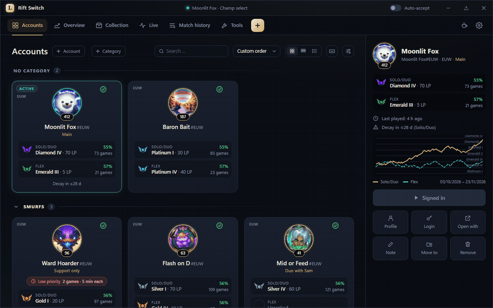
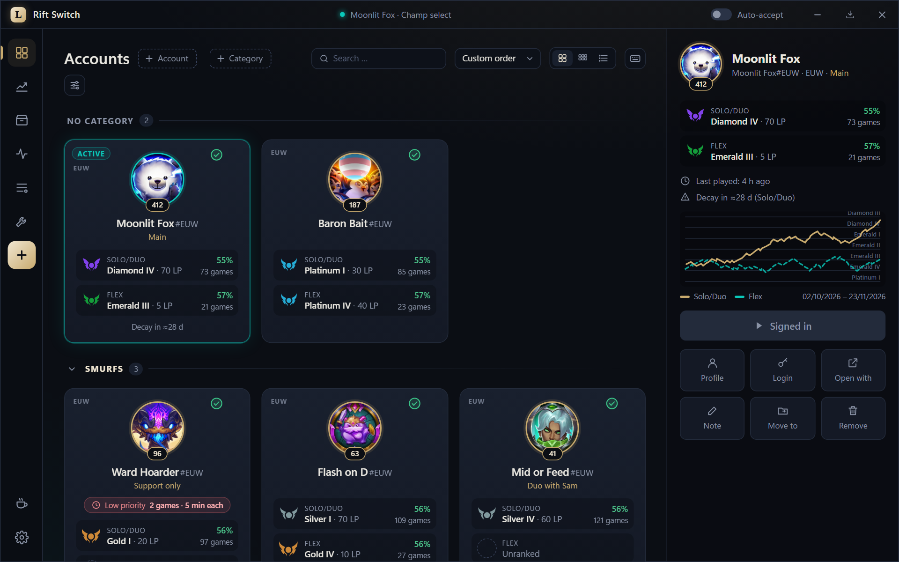
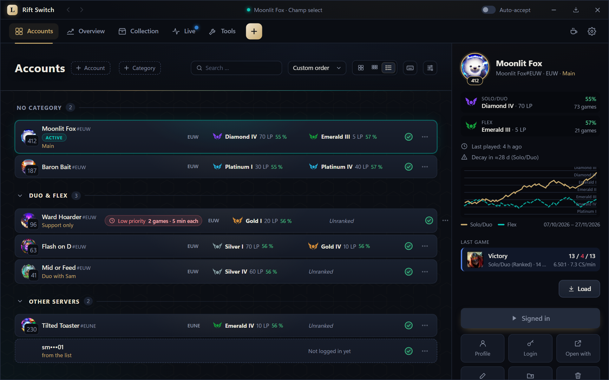
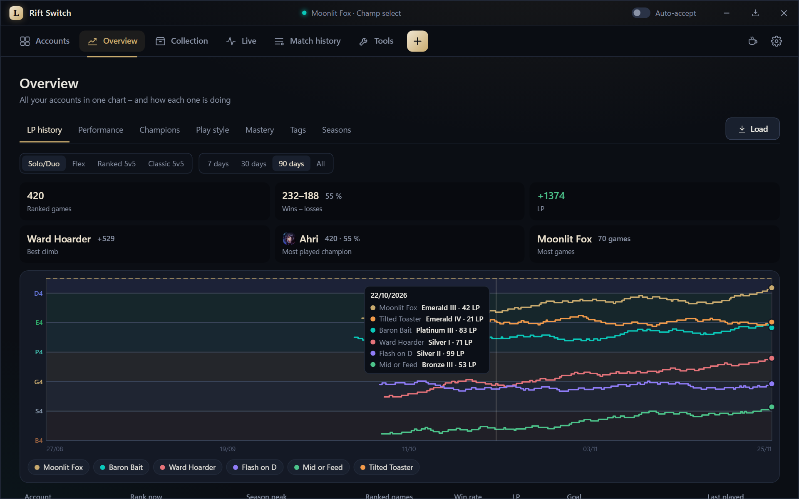
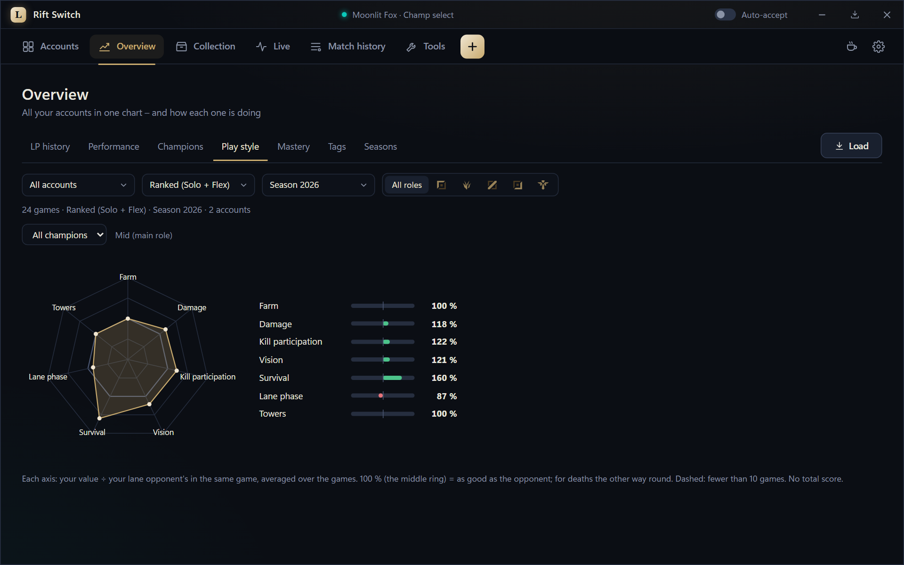
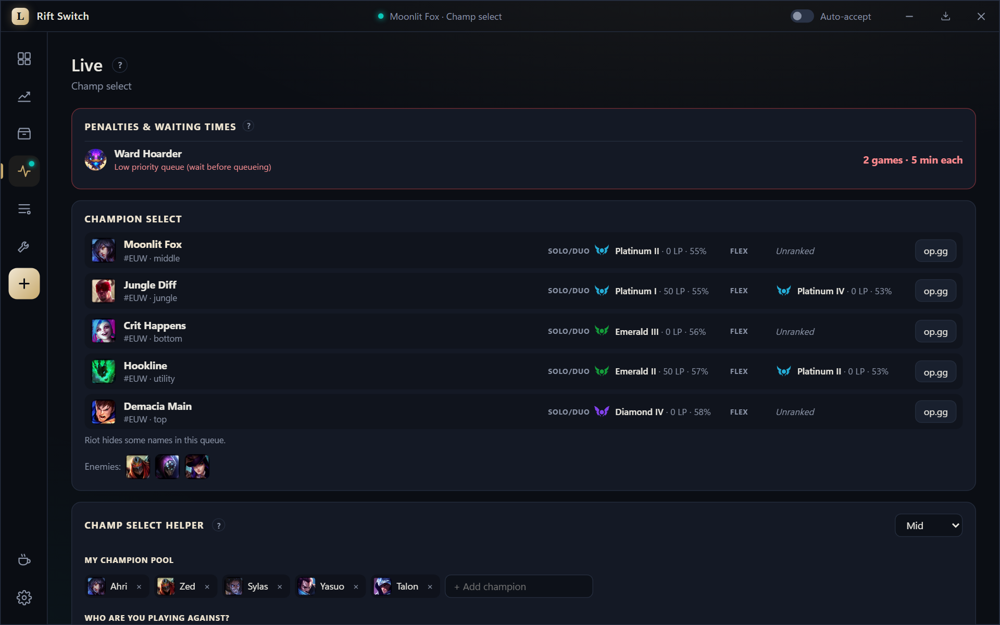

<div align="center">


# Rift Switch

**The local multi-account companion for League of Legends.**<br>
Pick an account, press **Log in** – League restarts with it. No typing, no logging out by hand.

[](https://github.com/Zlizz3R/rift-switch/releases/latest)
[](https://github.com/Zlizz3R/rift-switch/actions/workflows/ci.yml)


[](LICENSE)



<sub>Every account in the pictures is made up (`tools/screens/demo.js`).</sub>

</div>

## Why Rift Switch

- **One click per account** – it saves the Riot Client's *Stay signed in* session of every account and swaps it back
  in. Passwords are optional.
- **Everything about your accounts in one window** – ranks, LP history, penalties, collection, match history.
- **Light** – about **8 MB** in the tray with no window and almost no CPU, a **2 MB** installer. Rust + the WebView2
  that comes with Windows; no Electron.
- **Private** – logins and sessions never leave your PC (encrypted for your Windows user). No account, no tracking, no ads.
- **11 languages** – English, Deutsch, 中文, हिन्दी, Español, Français, العربية, বাংলা, Português, Русский, اردو.

## Download

**[⬇ Latest release](https://github.com/Zlizz3R/rift-switch/releases/latest)** → `Rift Switch_x.y.z_x64-setup.exe`

Start menu shortcut, uninstall via Windows settings, and it updates itself. The app isn't code-signed (that costs a
few hundred euros a year), so Windows SmartScreen may say *“Windows protected your PC”* – click **More info → Run
anyway**. The full source is right here.

---

## The pages

### 👤 Accounts



- **Log in** with a double click, the button in the panel, the tray menu or the Windows jump list. The app checks
  where the Riot Client is first: already signed in → it just presses *Play*; login screen open → it signs in
  without a restart; otherwise it leaves your lobby, closes League, swaps the session and presses *Play* for you.
- **Every tile** shows Riot ID, icon, level, server and ranks (Solo/Duo, Flex, Ranked 5v5, Classic 5v5) with win
  rate – which of these you see is up to you (the slider button).
- **The panel** on the right: ranks, last played, decay warning, LP chart, profile, saved login, *Open with* (op.gg,
  Porofessor, League of Graphs, Mobalytics, u.gg), note, move and remove.
- **Penalties on the tile** – leaver locks and dodge timers with the time left; a low priority queue with the games
  left and the wait per game.
- **Ranked readiness** – what a fresh account still needs (level 30, 20 champions, 10 normal games) plus Riot's own
  restrictions.
- **Categories**, search, sorting, drag & drop, and **several at once**: Ctrl+click, Shift+click or draw a box – then
  note, category, *Open with* or remove for all of them.

<details>
<summary><b>Three layouts</b> – tiles, small tiles or a list</summary>



The list shows what the tile options switch on; clicking, the menu, dragging and picking work just like on tiles.
</details>

<details>
<summary><b>Logging in, step by step</b></summary>


Saving the sign-in, Riot Client, entering the login, *Play*, League starting – you can hide it or cancel.

- An account with a **penalty** (leaver lock, low priority, dodge timer) always asks first.
- After the login the app checks that the **account you picked** is the one that signed in.
- **Code or captcha?** You get clear steps and an *Open Riot Client* button – the app notices the sign-in and goes on
  by itself.
</details>

<details>
<summary><b>Adding many accounts at once</b></summary>


Paste a list – one account per line: `user:password`, `user--Name#TAG--password` (LeagueAccounts format),
`user;password;Name#TAG;note` (also tab or `|`), a Riot ID alone, or blocks of `Username: …` / `Password: …` /
`Riot ID: …` lines. You see what was understood (and what wasn't) before anything is saved, and you can put them all
into one category.
</details>

### 📈 Overview



- **The LP history of every account in one chart**, on coloured tier bands. Hover: every account's rank on that day.
- **Any combination of queues** – Solo/Duo, Flex, Ranked 5v5, Classic 5v5: one colour per account, one line style
  per queue.
- **7 / 30 / 90 days or everything** – ranked games, wins and losses, LP won or lost and the best climb, for all
  accounts together and for each one.
- **A goal per account and queue** (e.g. Diamond II) with a progress bar and the LP still to go.
- **Key figures** across all accounts (games, win rate, LP, best climb, most played champion, busiest account) and each
  account's **season peak** and last season's rank, straight from the client.

<details>
<summary><b>Performance, champions, play style, mastery, tags, seasons</b></summary>


- **Performance** – one filter (account, queue, season, role) over all stored games: eight key figures, the trend of
  the last 10–100 games against the ones before, and a table by role that unfolds into its champions.
- **Champions** – the op.gg-style list: KDA, CS, win rate and games per champion; a click opens those games.



- **Play style** – a radar of you against your lane opponent in the same games (farm, damage, kill participation,
  vision, survival, lane phase, towers); 100 % = as good as him. No total score.
- **Mastery** – every champion's points over all accounts, milestones, and the play time behind them
  (points ÷ 850 × game length + 7 minutes around each game).


- **Tags** – "Great farmer", "Lane tyrant", "Dies to ganks" …: your strengths and things to work on from your ranked
  games, per role, each with the numbers behind it. "Too little data" is never shown as "not met".
- **Seasons** – what the client tells about the last season, your stored games per year, and earlier seasons you
  paste in yourself – three sources, never added up.
</details>

### 🧰 Collection


Owned champions, skins and loot shards of every account – and **one search across all of them**: which account has
Ahri, a K/DA skin or an Ashe shard? Without a search: champions, skins, chromas, ward skins, icons, emotes, finishers,
rune pages and Blue Essence per account, and all accounts together. (Read while you are logged in to that account.)

### 📊 Match history


- **Every game of every account** in one list, kept by Rift Switch itself – no limit, also with League closed.
  One **Load** button (on every page) fetches everything at once: collection, mastery, ranks and the 200 newest
  games of every account – the most the League client hands out. Rift Switch keeps them all, so the history grows
  with every Load. Your own games also keep the client's raw data (gzip, up to 2 × 100 MB); other players'
  games (from Live) stay 30 days – a year in their short form from the match list – and at most 1 GB (Settings → Data: 500 MB to 5 GB).
- **Filters**: account, any combination of queues, time or your own dates, wins/losses, champion, sorting, and more
  (kills, deaths, KDA, multikills). The summary above the list counts what the filters show: win rate, KDA, CS/min,
  damage, streaks and records.
- **Most played**: your top five champions, games and **play time per account**, and the teammates you played with
  most – each with its win rate. **Clash** games have their own filter.
- **Open a game**: every player's stats, items, runes and ranks, team gold over time (hover for the lead at each
  minute), and any two players side by side.

### ⚡ Live



- **Lobby, champion select and in game** – everyone's Solo/Duo and Flex rank, and a **Multi op.gg** button for the
  enemy team.
- **Clash** – your next opponents with their ranks as soon as the bracket is out.
- **Penalties & waiting times** of the account you are on and your other accounts in the lobby or game.


- **The ten players of your game** from the loading screen on: two rows, lane opponents face to face, rank, win rate
  on this champion, main role, mastery and tags – from each player's 200 newest games (all ten players' details
  for the newest 50 ranked ones), loaded from the client while the loading screen runs, with a
  progress bar; during the game it goes on slower (one game at a time, a round every 4 seconds, only while the
  window is open), so the game stays smooth. **Premades** get a coloured frame, players you met before a tag ("Yesterday: enemy (Kennen)"), and each
  team's **damage mix** (AD / AP / True) shows what to build against.
- **After the game**: the game's full details open right on the Live page – both teams, MVP / ACE, lane against
  lane, the gold lead, two players side by side – and what changed in your tags (▲ / ▼).
- A **blue dot** on *Live* while a game is on (champion select or in game), whatever page you are on.

<details>
<summary><b>Champ select helper</b></summary>


Keep a pool of your champions – typed in, or *Add from match history*: every champion you played 3+ times on the lane in
the last 180 days. The lane is your main role from the match history until you pick one. In champion select the enemy picks appear as pictures – Riot hides their positions, so the app
marks the likely laner (by how often each champion plays your lane). Your pool is ranked by win rate and counter
rating against him (counterstats.net). Every enemy pick loads in the background; *Pre-load all matchups* reads just
your own champions' pages while you queue – a matchup's win rates add up to 100, so they answer every enemy.
</details>

### 🔧 Tools & settings

- **Tools** – refresh ranks, close all Riot processes, restart League, clear the Riot Client cache (sign-ins stay),
  open the logs or the app's data folder, **save a diagnostics file** for a bug report (names, ids and your user
  folder are taken out).
- **Keyboard** – Ctrl+F search, Ctrl+1…6 pages, Ctrl+N add (Ctrl+Shift+N many), arrow keys + Enter to log in,
  E note, P profile, Del remove, Ctrl+A pick all – `?` shows them all.
- **Auto-accept** in the title bar, **streamer mode** (hide names, ranks … – you choose), system / light / dark,
  interface size, app lock with a password (and Windows Hello to show a saved password).
- **Export / import** – without logins (a safe backup), or with logins encrypted by a password of their own
  (scrypt + AES-256). Riot Client sign-ins, the app password and the match history are never in the file.
- **What's new** after every update, **tray app** (⬇ keeps it in the tray, ✕ quits), start with Windows.

---

## How it works – and what it stores

- **An account is a snapshot** of the Riot Client's *Stay signed in* session
  (`%LOCALAPPDATA%\Riot Games\Riot Client\Data`). Logging in restores that snapshot.
- **A password is optional** – for when a session has expired. It is typed into the Riot Client window
  (`src-tauri/scripts/autofill.ps1`, *Stay signed in* ticked); the app never talks to Riot's servers itself. It only
  types when it recognised the login form, only while the Riot Client is the front window, and it checks that every
  click lands on the Riot Client.
- Everything is stored in `%APPDATA%\rift-switch`, with a daily backup of your accounts for the last 5 days (`backups\`). Sessions and passwords are **encrypted with Windows DPAPI** – only
  your Windows user on your PC can read them.
- **Outside connections** (the same list is in the app: Settings → About → *Data sources*) – no account data is sent
  anywhere:
  - **CommunityDragon** – icons, rank emblems, champion, skin and item pictures.
  - **counterstats.net** – champion names only, for the champ select helper.
  - **GitHub** – every 6 hours: is there a newer version? The installer is checked (size, SHA-256) and only runs when
    you say so.
  - op.gg and the other sites only when you open a profile there yourself.
- **On your PC only**: the Riot Client and League Client API (`127.0.0.1`) – the same local interface the client uses
  itself.

> ⚠️ The local client API is used by many community tools but is not officially supported by Riot.
> Automatic login and auto-accept only do what you would do by hand – use them at your own discretion.

## Troubleshooting

| Problem | What to do |
|---|---|
| *Riot Client not found* | Install the Riot Client (or start it once by hand), then try again. |
| The login screen or sign-in wasn't ready in time | Open the Riot Client once by hand – it may be updating – then log in again. |
| League doesn't start after logging in | Make sure *Start League automatically* is on (Settings → Logging in). The app presses *Play* as soon as the Riot Client accepts it. |
| "Log in once by hand" | The account has no saved sign-in yet (or it expired and no password is saved): log in once in the Riot Client with *Stay signed in*. |
| A code or captcha while signing in | Click *Open Riot Client* in the box, enter the code or solve the captcha – the app notices the sign-in and goes on. |
| Signed in as another account than picked | The saved login of that account belongs to another Riot ID: open *Login* on the tile and fix it. |
| Ranks, collection or match history stay empty | They come from the League client: open League on that account once. Accounts of another server are filled in when League runs on that server. |
| The Riot Client window is blank or broken | Tools → *Clear Riot Client cache* (sign-ins stay), then restart League. |
| Anything else | Tools → *Save diagnostics* and attach the file to an [issue](https://github.com/Zlizz3R/rift-switch/issues). |

## Build from source

Requires [Rust](https://rustup.rs) (with the Visual Studio C++ build tools) and [Node.js](https://nodejs.org) on Windows.

```powershell
git clone https://github.com/Zlizz3R/rift-switch.git
cd rift-switch
npm install
npm run dev      # run it
npm run dist     # installer in src-tauri/target/release/bundle/nsis/
```

<details>
<summary><b>Development notes</b></summary>

- `src-tauri/src/` – the background part (Rust, Tauri 2):
  `main.rs` window, tray, the one `call` command the window uses, logging in, polling;
  `riot.rs` Riot Client / League Client API, sessions, processes; `events.rs` client events (WebSocket);
  `live.rs` live page data, champion data, matchups; `matches.rs` the match history store (no limit:
  `matches/games.jsonl`, only an index stays in memory);
  `accounts.rs`, `ops.rs`, `settings.rs`, `store.rs`, `secrets.rs`, `menu.rs` – pure logic with tests;
  `updater.rs` GitHub releases; `winsys.rs` autostart and jump list
- `src-tauri/scripts/` – typing a login into the Riot Client (UI Automation, picture scan as fallback), closing the PBE dialog
- `ui/` – the window (`index.html`, `style.css`; `tauri-api.js` is its link to the background part):
  - accounts and frame: `renderer.js`, `views.js` (also Live and the champ select helper), `bulk.js` + `bulkparse.js`,
    `keys.js`, `changelog.js`
  - Overview: `dashboard.js`, `ovfilter.js`, `perf.js` + `perfmath.js`, `radar.js` + `radar-view.js`, `mastery.js` +
    `mastmath.js` + `playtime-rules.js`, `seasons-view.js` + `seasonparse.js`, `insights.js`
  - tags: `tag-rules.js` (every threshold), `tags.js` (the engine), `tags-view.js`
  - collection: `collection.js`; match history: `matches-view.js`, `matchfilter.js`, `postgame.js`
  - Live: `scout-view.js` (the ten cards), `live-more.js` (premades, damage mix, helper by phase)
  - shared figures: `stats.js` (every key figure), `rankmath.js`
  - texts: `i18n.js` (English, German) + `lang/*.js` (loaded only when chosen)
- Tray and jump-list texts are copied from the window's texts: `npm run strings` after changing one
- Tests: `npm test` (the real window in jsdom with a fake background part + `cargo test`); they run on every push
- Pictures and the demo video: `node tools/screens/demo.js`, then `python tools/screens/capture.py` (headless Edge, ffmpeg)
- Releases: add the version's notes to `ui/changelog.js` (the app's *What's new* and the release text,
  `node tools/release-notes.js vX.Y.Z`), then push a tag `vX.Y.Z` matching the version in `src-tauri/tauri.conf.json` –
  GitHub Actions builds and publishes the installer, installed copies update themselves
- Test copy on its own data folder: `$env:RS_DATA='<folder>'; .\src-tauri\target\debug\rift-switch.exe`
  (never touches autostart, the jump list or the real data)
- **After every change** (AI helpers working on this project do all of this on their own):
  1. run **all** tests: `npm test` (the window tests and `cargo test`);
  2. **commit** – right away, without asking;
  3. **build again** with `npm run dist`, so `Rift Switch.cmd` (it starts
     `src-tauri\target\release\rift-switch.exe`) runs the new version right away. A running Rift Switch
     locks that file – close it first (`taskkill /IM rift-switch.exe /F`, no need to ask).
  **Pushing** only after asking.
</details>

## Support

Rift Switch is free and open source. If it saves you some clicks, you can [buy me a coffee ☕](https://buymeacoffee.com/zlizz3r) – thank you!

## Legal

Rift Switch isn't endorsed by Riot Games and doesn't reflect the views or opinions of Riot Games or anyone
officially involved in producing or managing Riot Games properties. Riot Games, and all associated properties
are trademarks or registered trademarks of Riot Games, Inc.

## License

[MIT](LICENSE)
